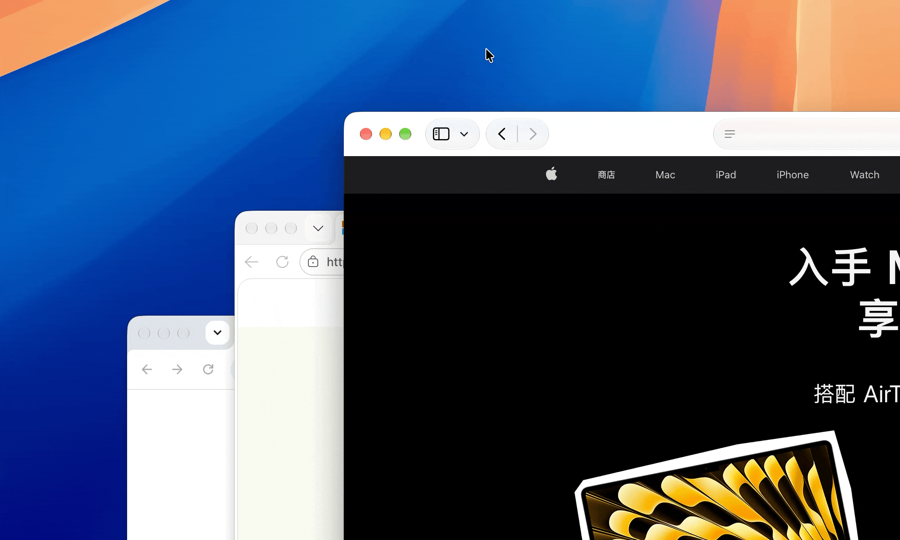

[English](./README.md) | 中文

# FocusTrafficLight

macOS 菜单栏应用，自动管理窗口焦点恢复。



关闭、最小化或隐藏窗口后，焦点会自动移到下一个可见窗口——就像你自己点了它一样，
不用再去够鼠标或按 `Cmd+Tab`。

## 功能

- **自动焦点恢复**: 窗口关闭、最小化或隐藏后，自动将焦点聚焦到最顶层的可见窗口
- **关闭和最小化触发**: 支持 `Cmd+W`、`Cmd+M`，以及点击红灯关闭、黄灯最小化
- **最小化兜底**: 对完全无视 `Cmd+M` 的应用（如 Parallels Desktop）代为最小化，焦点照样能移动
- **应用隐藏支持**: `Cmd+H`，以及微信、QQ、飞书等自带隐藏快捷键的应用，隐藏后自动聚焦下一个窗口
- **兼容性好**: 普通应用和 v2rayN、Keynote 保存面板等非标准窗口都能正常处理
- **菜单栏控制**: 简洁的菜单栏界面，一键开关
- **应用内更新**: 菜单里可检查新版本并直接安装，无需离开应用；菜单同时显示当前版本号

## 系统要求

- **macOS 27 及以上**：使用 v27.x 版本
- **macOS 15 及更早**：请使用 **V4 版本** — [v4.0.6](https://github.com/xdzgithub/FocusTrafficLight/releases/tag/v4.0.6)
- 需要辅助功能权限

## 版本号

版本号跟随 macOS 版本：**`V<系统主版本>.<系统次版本>.<修复序号>`**。

| 你的 macOS | 应下载的版本 |
| --- | --- |
| 27.2 | V27.2.0 |
| 27.2（该版本下的修复） | V27.2.1、V27.2.2… |
| 27.3 | V27.3.0 |

本应用依赖 macOS 的窗口与辅助功能接口，而每个 macOS 版本都可能改动这些接口（例如 macOS 27 就移除了本应用原先依赖的几个私有接口，因此才有了重写的 v5.0.0）。版本号带上系统版本，是为了让你能直接找到与自己系统对应的构建，避免装到不匹配的版本。

## 安装

1. 下载 `FocusTrafficLight_v27.2.0.dmg` 并双击打开
2. 把 **Focus TrafficLight** 拖入旁边的 **Applications** 文件夹
3. 首次启动时授予辅助功能权限，**授权后需重启应用**

## 使用

- 点击菜单栏图标查看状态
- "Enable Focus" 开关控制是否启用焦点恢复
- "Launch at Login" 设置开机自启

## 排查问题

应用的决策过程会写入统一日志，可用以下命令实时查看：

```sh
log stream --predicate 'subsystem == "com.focustrafficlight.app"' --level notice
```

正常时应依次出现 `Permissions — accessibility=true`、`Traffic light mouse tap created`，
以及 `Focus trigger queued` → `Focus check triggered` → `Focusing: <应用名>` → `Activate <应用名> via … frontmost=true`。

## 隐私

本应用需要辅助功能权限来监控窗口事件。权限仅用于焦点管理，不会收集或传输任何用户数据。

## 许可证

本项目基于 [MIT 许可证](./LICENSE) 发布。
